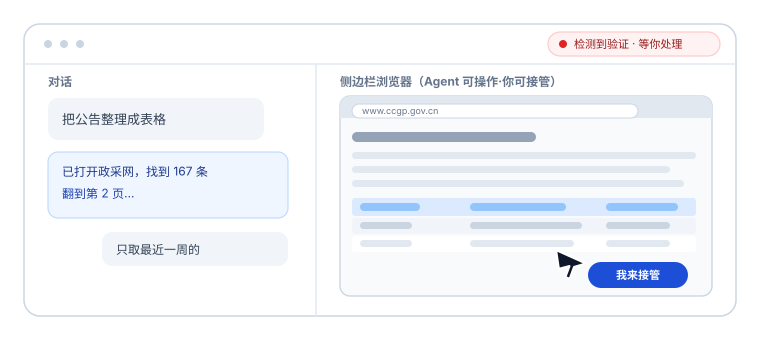
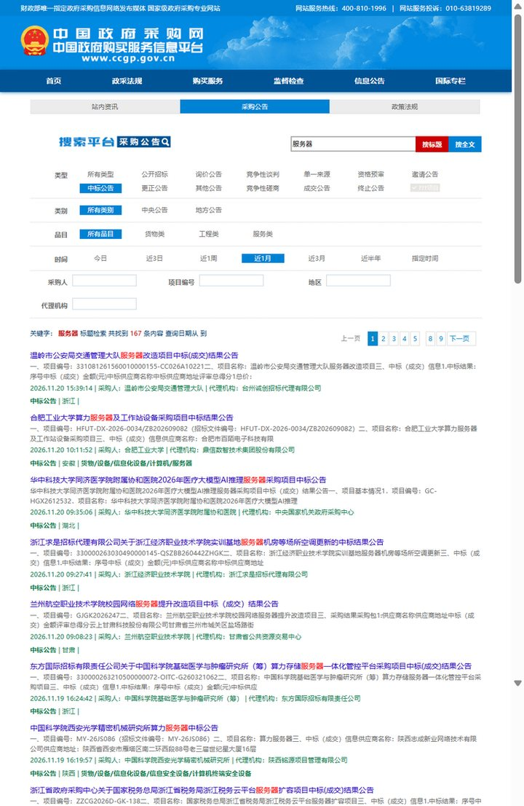
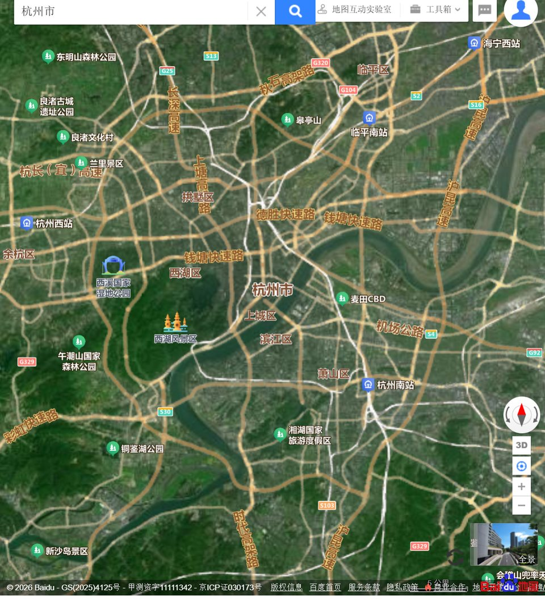

<div align="center">


# 侧边栏 Agent 浏览器

**在 DeepSeek Harness 的右侧栏里开一个真浏览器：Agent 看得见、点得动，你随时可以接管。**

`dsh-plugin-agent-browser` · DSH 桌面端插件

<p>
  
  
  
  
  
  
</p>

[快速开始](#快速开始) · [它能做什么](#它能做什么) · [十一个工具](#十一个工具) · [接管](#人机验证与接管) · [安全](#安全与隐私) · [配置](#配置) · [真实案例](#真实案例) · [文档地图](#文档地图)

</div>

<p align="center"></p>

内置的 `web_search` / `web_fetch` 负责「匿名、快速、只读」地取网页文字；这个插件负责「用你的登录身份、看得见、能动手、能留证据」的那一半。

## 为什么需要它

模型自带的联网工具很强，但它们是匿名的、只读的，也拿不到 JS 渲染之后的页面。而真实的活——查自己的订单、下载附件、在政府采购网站翻页取数、在地图上切图层——需要的是一个**浏览器**，还需要**你随时能把鼠标抢回来**。

| 你要做的事 | `web_search` | `web_fetch` | 本插件 |
|---|:---:|:---:|:---:|
| 找网址、找资料在哪 | ✅ | | |
| 读公开的静态文章、文档 | | ✅ 最便宜 | |
| 打开 JS 渲染 / 登录后才有的页面 | | ✗ | ✅ |
| 用你的登录态（Cookie、扫码、账号） | | ✗ | ✅ |
| 点按钮、填表、翻页、悬停、缩放 | | ✗ | ✅ |
| 留下「当时页面长这样」的证据 | | | ✅ |
| 遇到人机验证 | | | 检测到就交给你 |

判据、计费与边界讨论见 [`docs/web-tools-and-agent-browser.md`](docs/web-tools-and-agent-browser.md)。

## 它能做什么

| 能力 | 具体是什么 |
|---|---|
| **侧栏里的真浏览器** | Electron `<webview>`，不是截图流、也不是无头浏览器。登录态、Cookie、JS 渲染、跨域 iframe 都是真的，页面就在你眼前 |
| **快照带 `ref`** | `browser_snapshot` 把无障碍树 + 一张截图一起给模型，可交互元素都带 `[ref=eN]`；点击、输入、悬停直接用 ref，不用猜坐标 |
| **十一个工具** | 打开 / 快照 / 点击 / 滚动 / 悬停 / 缩放 / 截图 / 输入 / 按键 / 求值 / 下载，覆盖一个正常人会用浏览器做的事 |
| **验证墙不硬闯** | 检测到 Cloudflare、reCAPTCHA、滑块这类验证页就停下，把控制权交给你；你过完再交还，Agent 会收到一段「你不在时发生了什么」的摘要 |
| **证据落盘** | 截图默认拼接整页，下载件落盘，两者都带尺寸 / 字节数 / sha256，能直接当报告附件 |
| **失败不毁现场** | 导航失败自动退回上一页，错误里带 `nav_dns` / `nav_cert` / `nav_blocked` 等具体原因；错误页上不会返回空树假成功 |
| **过程看得见** | Web 端为截图 / 打开 / 下载各出一张工具卡片，模型调了什么、页面长什么样，一眼可查 |
| **工程化底座** | 动态端口 + 每进程令牌、13 个稳定错误码、取消、策略接缝、180 个单测 |

## 快速开始

### 1. 确认环境

| 项 | 要求 |
|---|---|
| 宿主 | **仅 DSH Desktop（Electron）**。面板依赖 `<webview>` 与 `globalThis.dshDesktop.browser` 租约，Web 版没有这两样 |
| DSH 版本 | `>=0.2.2-rc.3 <0.3.0`（本机实测 `0.2.2-rc.5`） |
| 操作系统 | Windows / macOS 桌面端 |
| 网络 | 通道只监听 `127.0.0.1`；页面访问走面板自己的网络栈，带你的登录态 |

### 2. 装包

在对话里让 Agent 安装仓库里的 tgz（装完**不需要重启** DSH）：

```text
plugin_manager action: install_bundle
                target: dist/dsh-plugin-agent-browser/dsh-plugin-agent-browser-1.4.13.tgz
```

### 3. 打开面板

点右侧栏上的 **+**，在引导页里选 **「浏览器（Agent）」**。首次打开会让你自己登录目标站点，登录态留在面板里，同一进程内后续页面与 Agent 直接复用。

### 4. 让它干活

> 打开 https://www.ccgp.gov.cn ，搜「服务器」最近一周的中标公告，把前三条整理成表格。

Agent 会自己走完 `browser_open` → `browser_snapshot` → 按 ref 点搜索框、点「搜索」→ 翻页 → `browser_screenshot`。你可以在面板里看着它一步步动。

### 5. 想自己接手

点面板顶部的 **「我来接管」**。此时 Agent 的 `open` / `click` / `type` / `press` / `eval` 全部被拒绝，但 `browser_snapshot` 仍然可用——它得能看见你做了什么。点「交还 Agent」时，面板会先截一张图，把交接摘要交给它。

## 十一个工具

| 工具 | 作用 |
|---|---|
| `browser_open` | 打开 http(s) 地址；或传 `path` 打开工作区里的 HTML（自动起只读本地服务） |
| `browser_snapshot` | 读当前页面的无障碍树（带 `[ref=eN]`）+ 一张截图；`includeImage:false` 可省掉截图 |
| `browser_click` | 点某个 `ref`；没有 ref 时传 CSS `selector`（失败会分型报告 `not_found` / `multiple` / `occluded` / `disabled`） |
| `browser_scroll` | 滚动页面或某个容器，返回位置与 `atBottom`；懒加载列表靠它触发 |
| `browser_hover` | 把指针移到元素上但不按，返回落点与 `grew`；叠卡、悬浮菜单要先 hover 再点 |
| `browser_zoom` | 缩放页面 25%–300%；缩小会给页面更宽的排版视口，桌面站才塞得进窄侧栏 |
| `browser_screenshot` | 存 PNG 到工作区 `screenshots/`，返回路径、尺寸、sha256；默认长页拼接成整页图 |
| `browser_type` | 往输入框写文字，`submit:true` 顺带回车；**密码框一律拒绝**，交给人来输 |
| `browser_press` | 按一个键或组合键；`Alt+Left` / `Alt+Right` / `F5` 会走面板的导航动作 |
| `browser_eval` | 在页面里求值（不够用时才用，永远不要用它绕过登录或验证）；可整体关闭 |
| `browser_download` | 把附件下到工作区 `downloads/`，返回路径、字节数、sha256；可执行类扩展名会被拒 |

> `browser_snapshot` 默认每次附图。截图对视觉 token 不便宜，这是刻意的取舍：Agent 看不到页面就只能猜。需要省 token 时传 `includeImage:false`。

## 它是怎么工作的

```text
Agent（对话）
   │  browser_* 工具调用
   ▼
host 半 · 注册工具 / 策略 / 下载 / 静态服务
   │  长轮询：127.0.0.1 动态端口 + 每进程令牌
   ▼
client 半 · 侧栏 tab / 四态徽章 / 三张工具卡片 / <webview>
   │  executeJavaScript
   ▼
页面注入层 · snapshot / actions / detect / guards
```

- **为什么要三层**：工具跑在宿主侧，才有文件与网络权限；`<webview>` 只能活在渲染器里；页面内的遍历与命中必须进页面执行。三层之间只有一条本机回环通道。
- **为什么不用 CDP / Playwright**：桌面端已经把浏览器租约给了渲染器，再拉一个外部 Chrome 就不是"侧栏里那一个"。取舍见 [`decisions/005`](decisions/005-loopback-bridge-over-cdp.md)。
- **为什么长轮询**：面板侧只能发起请求，宿主拿不到渲染器的主动推送。长轮询 + 队列是这个约束下最省事的一条路。

## 人机验证与接管

面板顶部有一条徽章，四种状态：

| 状态 | 含义 |
|---|---|
| `Agent 正在操作（mm:ss）` | Agent 在用 |
| `等待你处理（人机验证）` | 检测到验证页，输入类工具被拦下 |
| `你已接管（mm:ss）` | 你在面板里自己动手 |
| `空闲` | 没人动 |

- **只检测，不绕过**。遇到 Cloudflare / reCAPTCHA / 滑块，页面内画一圈红框提示你，Agent 的调用拿到 `needs_human`，它应当把控制权交给你而不是硬试。
- **密码永不进入对话**。`browser_type` 对密码框一律拒绝，密码由你在面板里输入。
- **交接有摘要**。交还时截一张图 + 一段文字摘要，Agent 下一次快照就能读到「你不在时页面变成了什么样」。

## 安全与隐私

- 通道**只监听 `127.0.0.1`**，动态端口 + 每进程 43 字符令牌 + Host 校验；令牌只经宿主发现路由下发给面板。
- 本地静态服务**只读、仅当前工作区**、随机端口 + 路径令牌 + 双重路径校验，拒绝目录穿越与符号链接。
- **密码框内容永不进入模型上下文**；`browser_eval` 可整体关闭（`evalEnabled: false`）。
- 下载默认拦截 24 类可执行扩展名，单文件 50 MiB 上限，重名不覆盖。
- `sessions.allowlist` 可以限定只有哪些会话能驱动浏览器（子代理默认拿不到）。
- 截图与下载只落在工作区的 `screenshots/`、`downloads/`。

## 配置

在 `cordis.patch.yml` 里给插件写 `config` 时，**这一行是整行替换，不是深合并**：只写一个字段，其余字段会全部回到默认值。正确写法是把整份配置抄全、只改你要改的那几行。完整 24 行模板与 16 个字段的说明见[用户手册](dist/dsh-plugin-agent-browser/README.md#配置)。

最常改的三个旋钮：

| 字段 | 默认 | 说明 |
|---|---|---|
| `activation` | `auto` | `auto` 只有需要页面的动作才展开面板；`always` 每次都亮；`manual` 要你自己先开 |
| `evalEnabled` | `true` | 是否允许 `browser_eval` 在页面里跑任意 JS；不可信页面建议关 |
| `searchFallback.enabled` | `false` | 导航失败时附上同站候选（按次计费，默认关，绝不自动打开） |

## 真实案例

<table>
  <tr valign="top">
    <td width="40%">
      
      <br />
      <sub><b>整页拼接截图</b> · 中国政府采购网「服务器」近一周 167 条结果，滚 2 帧 + 尾帧拼成 768 × 2472 的 PNG，页头到页脚连续无重复。</sub>
    </td>
    <td width="60%">
      
      <br />
      <sub><b>JS 地图 + 坐标点击</b> · 搜索「杭州市」→ 点地球卡片切到卫星视图 → 整页截图。canvas 与跨域 iframe 用坐标命中。</sub>
    </td>
  </tr>
</table>

已经跑通的完整案例（含判定标准、失败步与证据）：

- **政采中标取数**：167 条 → 3 条核验，合计 11,406,200 元 → [`research/R4-政府采购.md`](research/R4-政府采购.md)
- **交付链**：素材落盘 → `report.docx` 3 页 → 三跳审计 `pass:true`，6 个 URL 全 200 → [`research/R8-交付链/`](research/R8-交付链)
- **1688 选品**：验证墙 → 人工过滑块 → 登录 → 续跑搜「男士马丁靴」，取 3 款商品并 3/3 回访 → [`research/S5-商品清单.md`](research/S5-商品清单.md)
- **操作能力 V1–V12、任务级 T1–T8、硬化 H1–H8、实操 S1–S6**：34 个案例的执行记录在 [`reference/`](reference)

## 已知限制

- **仅桌面端**。Web 版 profile 没有 `<webview>` 与浏览器租约，启用后面板不出现、工具返回明确的 `unavailable` / `panel_not_open`，不会静默超时。
- **一个 profile 只能启用一个浏览器后端**。两套插件都注册 `browser_*` 工具，宿主会拒绝第二次注册；启用前先停掉另一个。
- **DSH 窗口在后台或最小化时不绘制**，也不接收合成输入：点击会"没反应"、截图会超时。把窗口切到前台即可，这不是插件 bug。
- **跨域 iframe 只能给占位**，里面的元素必须用坐标点；canvas 同理。
- **验证墙可能漏报**。检测器按 URL / 标题 / DOM / 文案判断，真实 Cloudflare 挑战页有漏报记录（[`tickets/033`](tickets/033-challenge-detection-gap.md)）；上线按"检测可能不触发，请人工接管"使用。
- **`browser_download` 走宿主侧 `fetch`，不带页面 Cookie**：需要登录态才能下载的链接会拿到登录页而不是文件。
- **`target=_blank` 的附件是黑洞**：点了既不导航也不落盘，附件一律用 `browser_download({ url })`。
- **取消只保证"不再等、不再下发新命令"**，已经发到页面里的动作不会撤销。
- **整页拼接有上限**：默认 10000 CSS 像素、最多 16000 设备像素行，超了会停下并在结果里标 `truncated`。

更多已知问题与处置见[用户手册 · 故障排查](dist/dsh-plugin-agent-browser/README.md#故障排查)。

## 文档地图

| 文档 | 内容 |
|---|---|
| [用户手册](dist/dsh-plugin-agent-browser/README.md) | 安装 / 升级 / 卸载、16 个配置字段、11 个工具、故障排查 |
| [与内置联网工具的分工](docs/web-tools-and-agent-browser.md) | 三层能力对比、`search → fetch → open` 判据、计费风险 |
| [为什么不复用官方浏览器工具](docs/browser-use-contract.md) | 48 行互斥锁、MCP provider、三条路线对比 |
| [技术规格](spec/001-agent-browser-plugin-spec.md) | 工具契约、状态机、快照格式、安全边界 |
| [官方对齐规格](spec/002-official-alignment-spec.md) | B1–B11 / M1–M5 / U1–U7 与版本线 1.1.0–1.4.3 |
| [决策记录](decisions/README.md) | 9 篇：通道选型、为什么不用 CDP、动态端口与令牌…… |
| [取证与验收](reference) | 探针结果、快照引擎、接管、打包、spec 审计、四套案例集 |
| [ticket 列表](tickets) | 34 张，含失败模式与验收证据 |
| [发布说明](docs/release-notes-1.4.md) | 1.4.3 产物、行为变化、未验证项、回滚 |
| [工作区日志](PROGRESS.md) | 开发期进度、踩坑、下一步 |

## 开发

仓库是纯 JS，**没有构建步骤**；插件源码在 `plugin/`，发布产物在 `dist/`。

```bash
# 单测（180 例）
node --test --test-timeout=60000 plugin/test/*.test.mjs

# 打包 tgz
node tools/pack.mjs

# 文档 ↔ 代码一致性（配置字段 / 工具名 / 示例 YAML / 决策索引 / B11 引用）
node tools/check-docs.mjs
```

README 里的两张案例图由 `python tools/make-readme-assets.py` 从真实截图重新生成（Pillow，可选）；`docs/assets/hero.svg` 是手写的示意图。

开发循环是「改 `plugin/` → `node tools/pack.mjs` → `plugin_manager install_bundle <tgz>`」，约 10 秒。改 `client.js` 要 bump `CLIENT_REV` 才会重新执行 client 半。更多约定（哪些字段能热改、重装后第一条命令为什么超时、link 安装的坑）写在 [`PROGRESS.md`](PROGRESS.md) 末尾。

## 反馈

- 用着有问题、想要新工具：开 [issue](https://github.com/linhuanwen/dsh-plugin-agent-browser/issues)。
- 安全相关：先开一个不含复现细节的 issue 说明来意，细节我们私下对。

## License

[MIT](LICENSE) © 2026 linhuanwen
